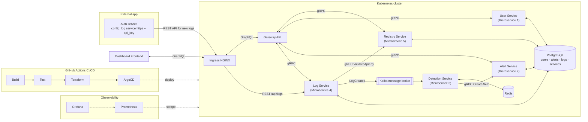
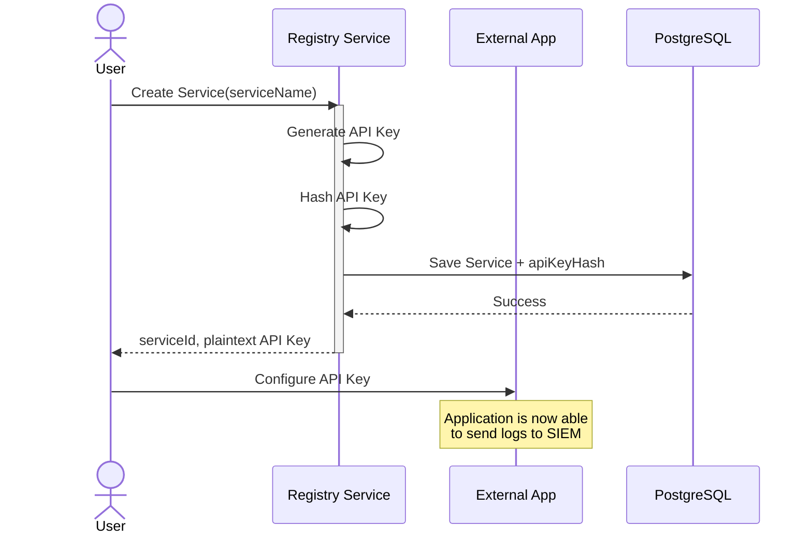
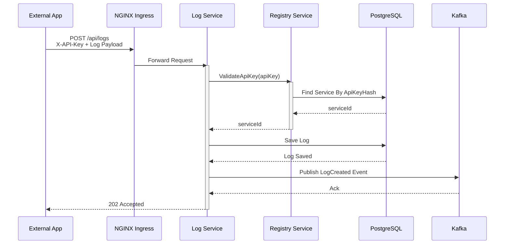
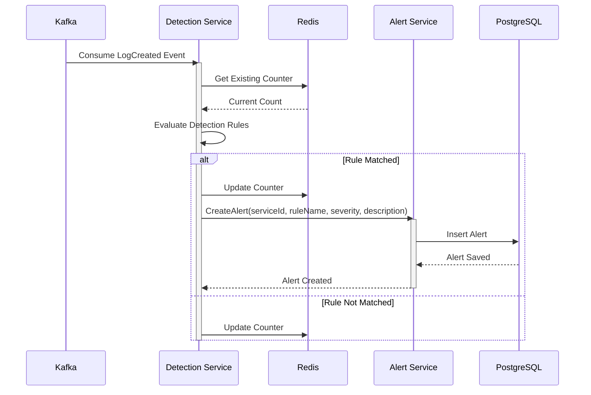
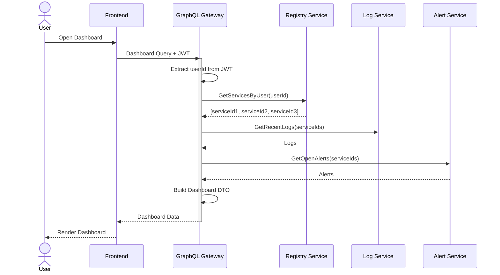
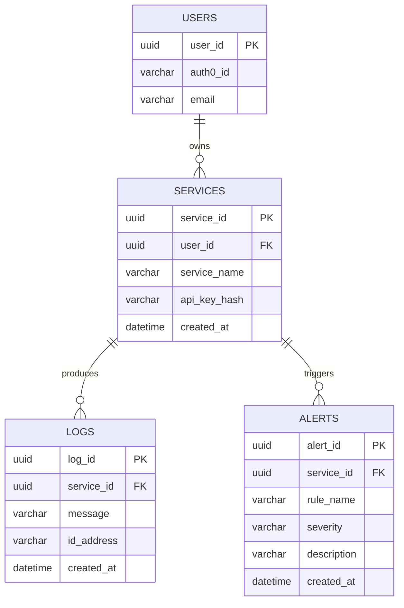

# siem-cloud

A cloud-native, multi-tenant **SIEM** (Security Information and Event Management) platform built as a learning project for microservice architecture.

Users register their applications, the applications ship logs to the platform over a REST API, logs are stored and streamed through Kafka to a detection engine, suspicious activity raises alerts, and everything is visible on a GraphQL-powered dashboard.

> **Status:** 🚧 Work in progress — see the [Roadmap](#roadmap).

---

## Table of contents

- [Goals](#goals)
- [Architecture](#architecture)
- [Services](#services)
- [Core flows](#core-flows)
- [Data model](#data-model)
- [Tech stack](#tech-stack)
- [Repository structure](#repository-structure)
- [Getting started](#getting-started)
- [Roadmap](#roadmap)
- [Design notes](#design-notes)

---

## Goals

This project exists to learn and practise:

- Designing and splitting a system into **microservices**
- Synchronous service-to-service communication with **gRPC**
- A client-facing **GraphQL** gateway that aggregates multiple services
- Event-driven processing with **Kafka**
- Stateful stream detection with **Redis**
- Authentication with **Auth0** (JWT / OAuth2)
- Infrastructure as code with **Terraform**
- Running on **Kubernetes** with GitOps (**ArgoCD**) and CI/CD (**GitHub Actions**)
- Observability with **Prometheus** and **Grafana**

---

## Architecture



- **Dashboard frontend** talks to the platform through **NGINX Ingress** → **GraphQL Gateway**.
- **External applications** send logs via a **REST API** (`POST /api/logs`) authenticated with a per-service API key.
- Internal services communicate over **gRPC**.
- The **Log Service** publishes events to **Kafka**; the **Detection Service** consumes them and keeps counters in **Redis**.
- State is persisted in **PostgreSQL**.
- Everything runs in a **Kubernetes** cluster, provisioned with **Terraform**, deployed by **ArgoCD**, monitored with **Prometheus + Grafana**.

---

## Services

| Service | Responsibility | Exposes | Talks to |
|---|---|---|---|
| **Gateway API** | GraphQL entry point for the dashboard; validates Auth0 JWT; aggregates data | GraphQL | Registry, Log, Alert, User (gRPC) |
| **User Service** | Provisions users on first login (Auth0 `sub` → `users`) | gRPC | PostgreSQL |
| **Registry Service** | Manages a user's services and their API keys; validates API keys | gRPC | PostgreSQL |
| **Log Service** | Ingests logs from external apps, stores them, publishes `LogCreated` events | REST, gRPC | Registry (gRPC), PostgreSQL, Kafka |
| **Detection Service** | Consumes log events, evaluates detection rules using Redis counters | — (Kafka consumer) | Kafka, Redis, Alert (gRPC) |
| **Alert Service** | Creates and serves alerts | gRPC | PostgreSQL |

---

## Core flows

### 1. Registering a service

A user registers an application. The Registry generates an API key, stores only its hash, and returns the plaintext key **once**. The user configures it in their external app.



### 2. Log ingestion

The external app sends logs with the `X-API-Key` header. The Log Service validates the key via the Registry, persists the log, publishes a `LogCreated` event to Kafka and responds `202 Accepted`.



### 3. Threat detection

The Detection Service consumes `LogCreated` events, reads/updates counters in Redis, evaluates detection rules and, when a rule matches, creates an alert through the Alert Service.



### 4. Dashboard

The frontend sends a GraphQL query with the user's JWT. The gateway resolves the user's services, then fetches recent logs and open alerts and returns a single dashboard DTO.



---

## Data model



- `users` **1 — n** `services`
- `services` **1 — n** `logs`
- `services` **1 — n** `alerts`

A **service** is the tenant boundary — every log and alert belongs to exactly one service, and every service belongs to exactly one user.

---

## Tech stack

| Area | Technology |
|---|---|
| Language | Java 21 |
| Framework | Spring Boot 3 |
| Internal API | gRPC (Protobuf) |
| Client API | GraphQL (Spring for GraphQL) |
| Ingest API | REST |
| Messaging | Apache Kafka |
| Cache / counters | Redis |
| Database | PostgreSQL + Flyway migrations |
| Auth | Auth0 (OAuth2 / JWT) |
| Frontend | TBD (e.g. React + Apollo) |
| Containers | Docker, Kubernetes |
| Ingress | NGINX Ingress Controller |
| IaC | Terraform |
| CI/CD | GitHub Actions + ArgoCD |
| Observability | Prometheus, Grafana (Micrometer) |
| Testing | JUnit 5, Testcontainers |

---

## Repository structure

Planned layout:

```
siem-cloud/
├── proto/                  # Shared .proto definitions (gRPC contracts)
├── services/
│   ├── gateway-service/
│   ├── user-service/
│   ├── registry-service/
│   ├── log-service/
│   ├── detection-service/
│   └── alert-service/
├── frontend/               # Dashboard
├── deploy/
│   ├── docker-compose.yml  # Local infra: Postgres, Kafka, Redis
│   ├── k8s/                # Kubernetes manifests / Helm charts
│   └── argocd/             # ArgoCD applications
├── infra/
│   └── terraform/          # Cloud infrastructure
├── docs/                   # Additional documentation
└── .github/workflows/      # CI pipelines
```

---

## Getting started

> Instructions will be filled in as the services are implemented.

### Prerequisites

- Java 21
- Maven or Gradle
- Docker & Docker Compose
- (later) kubectl, kind/minikube, Terraform

### Run local infrastructure

```bash
docker compose -f deploy/docker-compose.yml up -d
```

### Send a test log

```bash
curl -X POST http://localhost/api/logs \
  -H "X-API-Key: <your-api-key>" \
  -H "Content-Type: application/json" \
  -d '{"message": "Failed login for user admin", "ipAddress": "10.0.0.5"}'
```

---

## Roadmap

### Phase 0 — Foundations
- [ ] Multi-module build + shared `proto` module
- [ ] `docker-compose` with PostgreSQL, Kafka (KRaft), Redis
- [ ] Flyway migrations for the schema

### Phase 1 — Registry & ingestion
- [ ] Registry Service: create service, generate + hash API key
- [ ] gRPC `ValidateApiKey` and `GetServicesByUser`
- [ ] Log Service REST ingest endpoint with API key validation

### Phase 2 — Event pipeline & detection
- [ ] Publish `LogCreated` events to Kafka
- [ ] Detection Service consuming events with Redis-backed counters
- [ ] First rules: brute-force login, error-rate spike
- [ ] Alert Service `CreateAlert`

### Phase 3 — Gateway & auth
- [ ] Auth0 tenant, SPA application and API audience
- [ ] GraphQL Gateway as OAuth2 resource server
- [ ] User provisioning on first login
- [ ] `dashboard` query aggregating services, logs and alerts
- [ ] Tenant isolation checks

### Phase 4 — Frontend
- [ ] Login with Auth0
- [ ] Services list + API key creation
- [ ] Logs table and alerts list
- [ ] (optional) Live alerts via GraphQL subscriptions

### Phase 5 — Hardening
- [ ] Transactional outbox for log events
- [ ] Redis cache for API key lookups
- [ ] Rate limiting on the ingest endpoint
- [ ] Retries + dead-letter topic for the detection consumer
- [ ] Idempotent alert creation
- [ ] Integration tests with Testcontainers

### Phase 6 — Kubernetes
- [ ] Container images (Jib / Dockerfiles)
- [ ] Kubernetes manifests / Helm charts
- [ ] NGINX Ingress routing (`/api/logs`, `/graphql`)
- [ ] Local cluster with kind/minikube

### Phase 7 — Terraform & CI/CD
- [ ] Terraform for the cloud cluster and managed PostgreSQL
- [ ] GitHub Actions: build, test, push images
- [ ] ArgoCD GitOps deployment

### Phase 8 — Observability
- [ ] Micrometer metrics → Prometheus
- [ ] Grafana dashboards (ingest rate, consumer lag, rule hits, gRPC latency)
- [ ] (optional) Distributed tracing with OpenTelemetry

---

## Design notes

Decisions and open points to keep in mind:

- **API key hashing** — keys are looked up *by hash*, so a deterministic hash (SHA-256 / HMAC) is used rather than bcrypt/argon2, which are salted. Keys are long and random, so a fast hash is safe here.
- **Dual write (DB + Kafka)** — saving a log and publishing an event are two writes; the transactional outbox pattern will be used to make this reliable.
- **Alert status** — alerts need a `status` (`OPEN`, `ACKNOWLEDGED`, `RESOLVED`) to support "open alerts" on the dashboard.
- **Detection rules** — start hardcoded; later move to a `detection_rules` table so users can configure thresholds and windows.
- **Redis counters** — use time-bucketed keys with TTLs, e.g. `rule:{serviceId}:{ip}:{minuteBucket}`.
- **Database ownership** — each service owns its own schema/tables; no service reads another service's tables directly.
- **Schema** — `logs.id_address` → `ip_address`; consider adding `level`, `event_type` and a JSONB `metadata` column to logs.

---

## License

TBD
